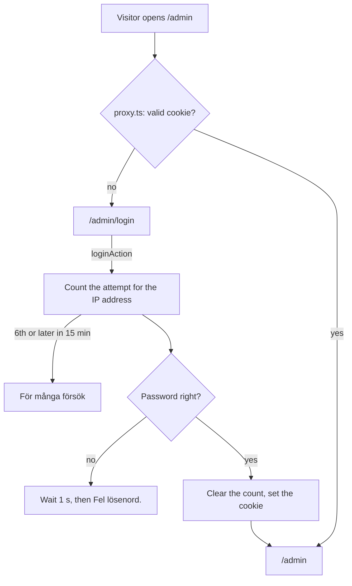

# Admin sign-in

Only the administrator can open `/admin` and change the airline's data. There is one shared password and no user accounts. The sign-in lasts until the browser closes, and at most 8 hours. The security points are also in [Architecture](architecture.md#admin-sign-in); this page says how the parts fit together.

## The pages

- **`/admin/login`** (`app/admin/login/page.tsx`, `LoginForm.tsx`): the heading "Admin", a password field and **Logga in**. The form uses `useActionState` with `loginAction`, which returns `{ error }` or redirects.
- **`/admin`** has **Logga ut** in its header, which runs `logoutAction`: it deletes the cookie and goes to the sign-in page.

## The session cookie

`lib/session.ts` makes and checks the cookie `gurrasflyg_admin`. Its value is `<expires>.<signature>`: the expiry time in milliseconds, and an HMAC-SHA256 of it made with `ADMIN_SESSION_SECRET` (with a version in front, `VERSION` in the file). Without the secret a valid cookie can't be made.

- The cookie is `httpOnly` (JavaScript can't read it), `secure` on the live site, `sameSite: "lax"` and `path: "/"`.
- It has **no expiry date**, so the browser deletes it when it closes. The expiry time inside it, `SESSION_HOURS` (8) after sign-in, is checked on every request.
- `isValidSessionToken()` rejects an old, missing or forged cookie. `safeEqual()` compares the signatures in constant time.

## Where the cookie is checked

Three places check it, so no single one has to be perfect:

1. **`proxy.ts`** runs before every `/admin` request. A visitor without a valid cookie is sent to `/admin/login`, and a signed-in one who opens the sign-in page is sent to `/admin`. It is a quick first gate, not the only one.
2. **`requireAdminPage()`** in `lib/auth.ts` is called by the admin page itself and redirects the same way.
3. **`isAdmin()`** in `lib/auth.ts` is called by every server action in `app/admin/actions.ts` through its `run()` helper (see [Administration](admin.md)). A server action can be called without opening the page, so it checks again and answers "Du är inte inloggad längre. Ladda om sidan och logga in."

`isAdmin()` waits for `connection()` first. The check compares the cookie's expiry time with the clock (`Date.now()`), which must not happen while Next.js prerenders a page.

## Checking the password

`loginAction` (`app/admin/login/actions.ts`) does these steps in order:

1. **No password set** (`ADMIN_PASSWORD` missing): locally it says what is missing; on the live site only "Inloggningen fungerar inte just nu.", so a visitor never sees the names of settings.
2. **Count the attempt** for the visitor's IP address (`clientIp()`: the first entry of `x-forwarded-for`, which Vercel sets; `local` when there is none) with the shared [rate limit](rate-limits.md). More than 5 within 15 minutes gives "För många försök. Försök igen om N minuter." even with the right password.
3. **Compare** with `passwordMatches()`: both sides are hashed with SHA-256 and compared with `timingSafeEqual`, so the response time says nothing about how many characters were right or how long the password is.
4. A wrong password is answered after **one second** ("Fel lösenord."), which makes guessing slow.
5. The right password clears the count, sets the cookie and goes to `/admin`.

## The limit on attempts (TECH-017)

`lib/login-limit.ts` counts attempts per IP address in the table `login_attempts` (migration `010_login_attempts.sql`): `ip`, `attempts` and `last_failed_at`. The attempt is counted **before** the password is checked, in one `INSERT … ON CONFLICT … RETURNING`, so many requests at once can't slip past the limit. Once an address is locked, `last_failed_at` stops moving, so continuing doesn't extend the lock. The window counts from the last counted attempt; old rows are deleted on every call so the table doesn't grow. The table is in the database, not in memory, since on Vercel each request may run in a server of its own.

[My booking](my-booking.md) uses the same functions for its lookup, under the key `uppslag:<ip>`.

## Decisions

- **A stateless cookie, not a session table.** Nothing is stored on the server. The price is that signing out only deletes the cookie in the browser; a copied cookie works until its 8 hours are up. Changing `ADMIN_SESSION_SECRET` (or `VERSION`) ends every session at once. That is acceptable here, since the admin has no real data.
- **The proxy is not trusted alone.** It only reads the cookie; the page and every server action check again.

## Tests

- Browser: `tests/TRIP-002-admin-sign-in.spec.ts` (guarded pages, wrong and right password, the cookie's flags, a forged cookie, sign-out) and `tests/TECH-017-login-limit.spec.ts` (the lock).
- Unit: `lib/login-limit.test.ts`.
- The 8 hour expiry can't be waited for in a test, so it was checked in code review; see `specs/TRIP-002-admin-sign-in/verification.md`.

Requirements and verification: `specs/TRIP-002-admin-sign-in/`, `specs/TECH-013-security/` and `specs/TECH-017-login-limit/`. For the administrator: [Logga in som administratör](../manual/admin-logga-in.md).

[System documentation](index.md)
