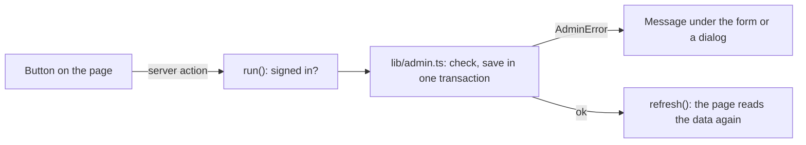

# Administration

`/admin` is where the administrator builds what the traveller later chooses from: **cabin classes**, **add-ons** and **aircraft**. It has three cards, each folded in and out with its heading (`CollapsibleCard`): **Klasser & addons** (the two tables side by side), **Plan** and **Omdömen** (see [Reviews](reviews.md)). The page needs [a sign-in](admin-sign-in.md). For the administrator: [Klasser och addons](../manual/admin-klasser-och-addons.md) and [Plan](../manual/admin-plan.md).

## The page

`app/admin/page.tsx` is a server component. The data is read from the database when the page is asked for, inside `<Suspense>` (the site has `cacheComponents` on): `listClasses()`, `listAddons()`, `listAircraft()` and `listReviews()`. The tables and forms are client components, one file each: `ClassTable`, `AddonTable`, `AircraftTable`, `AircraftForm` and `ReviewSection`. The admin's own pieces (collapsible card, labelled field, icon buttons, the delete button with its question, Spara and Avbryt) are in `app/admin/admin-ui.tsx`; see [Design](design.md).

## Changing data

Every button that changes something calls a **server action** in `app/admin/actions.ts`. They all go through `run()`:

1. `isAdmin()` checks the sign-in again (an action can be called without opening the page).
2. The change runs in `lib/admin.ts`.
3. An `AdminError` (a mistake the administrator can fix) is shown as it is; anything else is logged and shown as "Något gick fel, försök igen."
4. `refresh()` makes the page read the data again.

The action returns `{ ok: true }` or `{ ok: false, error }`, and the component shows the error as a `Message` under the form, or in a dialog for a delete.

### Checks on the server

TypeScript types only hold in the code, since an action can be called with anything, so `lib/admin.ts` checks everything at run time:

- **Ids** are integers (`requireId`). **Texts** are strings, not empty after trimming, and at most 200 characters (`requireText`).
- **Class names**, **add-on names** and **aircraft names** are unique regardless of case (`COLLATE NOCASE UNIQUE`); the database's error is turned into `Klassen "X" finns redan.` by `translateErrors`.
- **Prices** of add-ons are whole kronor, 0 or more (`parseKronor`). **Factors** are read by `lib/numbers.ts` (see [Aircraft and classes](aircraft-and-classes.md#factors)).
- **An aircraft** needs a name, at least one class, each class once with whole seats above 0, and every add-on must belong to one of its classes and appear once per class (`validateAircraft`).

### An aircraft is saved all at once

The form for an aircraft keeps everything in the component until **Spara**. Then `createAircraft()` or `updateAircraft()` saves the aircraft, its classes (`aircraft_capacity`) and its add-ons per class (`aircraft_class_addons`) in **one transaction** (`withTransaction`): either everything is saved or nothing. When an aircraft is changed:

- a class can't be removed if a booking with the aircraft has seats in it, and a class's seats can't go below the most seats any one booking has in it (TRIP-012);
- the add-ons are replaced by the ones sent in.

## What is in use (TRIP-016)

The trash can on a class, an add-on or an aircraft always asks "Är du säker?" (`DeleteButton`). Only the **server** decides if the row is in use, inside the delete transaction (`deleteClass`, `deleteAddon`, `deleteAircraft`); the page holds no such flag, since it can be old right after a change. If it is in use the dialog says "Du kan ej ta bort" with the server's reason:

| Row | In use when |
|---|---|
| Class | an aircraft has seats in it (`aircraft_capacity`) or a booking has (`booking_seats`) |
| Add-on | an aircraft sells it in a class (`aircraft_class_addons`) or a booking has it (`booking_addons`) |
| Aircraft | a booked flight uses it (`booking_flights`); its classes and add-ons are deleted with it |

Deleting an aircraft removes its `aircraft_capacity` and `aircraft_class_addons` rows, so a class or add-on that only that aircraft used can be deleted straight after.

## Data

| Table | Holds |
|---|---|
| `classes` | `name` and `price_percent` (the class's price factor) |
| `addons` | `name`, `description` and `price` in whole kronor |
| `aircraft` | `name`, `price_percent` and `time_percent` |
| `aircraft_capacity` | seats per aircraft and class |
| `aircraft_class_addons` | which add-on can be bought in which class on which aircraft |

They are created in `db/schema.sql`; the factors came with `008_factors.sql` and the prices became whole kronor in `004_whole_kronor.sql`. A new database starts with the classes Ekonomi, Business and Första klass (`db/seed.sql`) and no aircraft or add-ons.

## Routes (TRIP-005)

The airline's routes and departures are **data, not something the admin edits**. TRIP-005 added them together with a button **Tilldela plan** that gave every route an aircraft; that button and `routes.aircraft_id` are gone since TRIP-010 and TRIP-011, because the traveller now chooses the aircraft for each flight ([Aircraft and classes](aircraft-and-classes.md)). What is left:

- `routes` (every ordered pair of the 51 airports, with the flight time) and `route_departures` (daily departure times and prices): `001_routes.sql`, `002_routes_data.sql` (generated by `scripts/generate-routes.mjs`, 200 routes) and `007_all_routes.sql` (generated by `scripts/generate-all-routes.mjs`, every pair with at least 5 departures a day and a price). Both generators use a fixed random seed, so a run always gives the same result, and their output is not edited by hand.
- How the routes are searched and priced is in [Search results](search-results.md#the-route-data).

## Decisions

- **The server decides, the page only shows.** Checks, uniqueness and "in use" all live in `lib/admin.ts`; the forms check only to give quick feedback.
- **A change is one transaction.** An aircraft with its classes and add-ons never ends up half saved.

## Tests

- Browser: `tests/TRIP-003-admin-classes-and-addons.spec.ts`, `tests/TRIP-004-admin-aircraft.spec.ts`, `tests/TRIP-016-deleted-aircraft-in-use.spec.ts`; the look in `tests/TRIP-019-admin-design.spec.ts` and `tests/TECH-018-design.spec.ts`.
- Unit: `lib/admin.test.ts`, `lib/numbers.test.ts`, and for the route data `db/migrations/002_routes_data.test.ts` and `db/migrations/007_all_routes.test.ts`.

Requirements and verification: `specs/TRIP-003-admin-classes-and-addons/`, `specs/TRIP-004-admin-aircraft/`, `specs/TRIP-005-routes-and-aircraft-assignment/`, `specs/TRIP-016-deleted-aircraft-in-use/` and `specs/TRIP-019-admin-design/`.

[System documentation](index.md)
