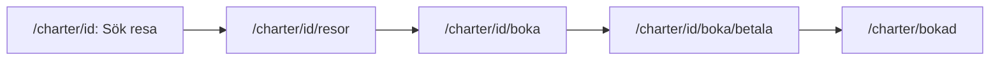

# Charter booking

A charter trip is always a round trip from Stockholm Arlanda (ARN) or Copenhagen (CPH) to a destination's airport and back to the same airport. The traveller searches on the destination page (`/charter/<id>`, see [Charter destinations](charter-destinations.md)), chooses an outbound and a return trip, fills in the travellers and the extras, pays, and gets a booking number that starts with `CH-`. The flight booking's steps are reused where they fit ([Booking](booking.md)); charter has no aircraft, classes or add-ons.

## The search form

`CharterSearchForm` (client) on the destination page, only when `tripTo()` finds a trip: **Avresa från** (Stockholm Arlanda or Köpenhamn Kastrup), **Utresa**, **Hemresa** (the shared `DatePicker`), **Resenärer** (`TravellerCount`, 1–10) and **Sök resor**. With a date missing the button marks it and says "Välj datum för utresan." or "Välj datum för hemresan.", and focus moves to the first. With valid values the browser goes to `/charter/<id>/resor?fran=ARN&utresa=2027-01-11&hemresa=2027-01-16&resenarer=2` (`resultsUrl()`).

**The dates.** `DatePicker` gets `runs(leg, day)`. The page sends the weekdays and periods of the timetables for each departure airport (`getSchedules()` in `lib/charter.ts`) and `runs` is `runsOn()` over them, so only a day when a timetable runs from the chosen airport to the destination's airport (Utresa), or back (Hemresa), can be chosen. The flight booking's rules still apply: today or later, at most six months ahead, a return from the outbound day to two months after (`lib/dates.ts`). A typed day with no trip says "Det går ingen resa den dagen.". Another airport clears the dates that don't run from it. "Tur och retur" is not offered.

## The results

`/charter/<id>/resor` (`CharterResults`). The server (`loadCharter()`) reads the search and the choices from the address, checks the dates (not passed, within the limits, the return not before the outbound) and reads every trip of the two dates. An address with an unknown airport, a wrong date, 0 or 11 travellers, a missing value or an unknown destination gives "Sökningen saknar något. Börja med att välja en destination." and a link to `/charter`; nothing is searched.

- **Which trips run.** `readTimetables()` (`lib/charter.ts`) reads the timetables of a route with their weekdays, flights and changes; `findTrips()` keeps those where `runsOn()` is true for the date and drops trips that have already left (the departure instant is not after now; for today that is local time at the departure airport).
- **The arrival** is worked out by `makeTrip()` (`lib/charter-rules.ts`): the departure date and time in the departure airport's time zone, plus the travel time, read in the arrival airport's time zone (`instant()` and `arrival()` from `lib/fare-rules.ts`). The course data's `arrives` is never used, since it doesn't follow summer time (see [Charter data](data-charter.md)). Example: `ARN-WDH-LH1570`, 06:25 and 840 min, lands 21:25 in Windhoek in winter and 20:25 after 28 March 2027.
- **The cards.** Each trip shows departure and arrival (with "+1" for a later day, "nästa dag" for screen readers), the airline and flight numbers, the travel time, "Direkt" or "1 byte i Frankfurt" / "2 byten i Frankfurt och Wien" (`stopsText()`), the price per person and **Välj** (`aria-pressed`, the chosen card has a ring and "✓ Vald").
- **Sorting.** `SortChoice` (shared with `/flyg`), by departure time or price (equal prices by time). The change is read out ("Sorterat på pris.") and doesn't search again.
- **Choosing.** Choosing an outbound trip opens the return list, which has only trips that depart after the outbound has landed (`tripsAfter()`: departure instant after arrival instant, so also across time zones and midnight). Choosing another outbound clears a return that no longer fits and keeps the rest. A day without trips says "Inga resor den här dagen." with a link back to the search; a return list that is empty only because of the outbound says "Inga hemresor går efter att utresan har landat.".
- **Din resa** (`CharterOverview`): the chosen trips ("Inte vald än" for the rest), the number of travellers and "Totalt för resan": (outbound price + return price) × travellers. **Fortsätt** appears when both are chosen.
- **The address** follows the choices (`window.history.replaceState`): `…&ut=ARN-BER-SK1122&hem=BER-ARN-SK1123`, the timetables' ids. A reload, or the steps' links back, read them again on the server and keep only what exists and fits.

Focus stays on the button that was pressed, and the page announces what happened ("Utresa vald: SK1122 kl 06:50. Välj nu hemresa.").

## Resenärer

`/charter/<id>/boka` (`CharterTravellersForm`): **Din resa** with the extras and the total beside the form (under it on a phone), a card per traveller (`PersonFields`: first name, last name, age 1–120), **Kontaktperson** (`ContactCard`), **Tre viktiga frågor** (`QuestionsCard`) and **Tillägg för hela resan**. The fields, checks and messages are the flight booking's (`passengerProblems()` and `contactProblems()` in `lib/booking-rules.ts`), but there are no classes, aircraft, add-ons per flight or Dåliga nerver. **Till betalning** marks what is missing (`aria-invalid`, red, the message read out) and moves focus to the first.

The form is personal data, so it is kept in the tab's `sessionStorage` under `gurrasflyg-charter`, never in the address (`app/charter/form.ts`, the same store as the flight booking's, `app/flyg/boka/store.ts`). `fitCharterForm()` fits it to the trip every time it is read: a changed number of travellers adds or removes travellers and keeps the rest.

### The extras

Defined once, in `EXTRAS` in `lib/charter-rules.ts` (code, name, text, price per person, `adultsOnly`): **Den ultimata upplevelsen** (1 000 kr), **Bear Grylls Experience** (2 000 kr) and **Dryckespaket XXXL** (4 000 kr, not with a traveller under 18). They are check boxes for the whole booking, in any combination, each with its price per person and for all travellers. With a traveller under 18 the drinks package is `aria-disabled` (focus still reaches it, a click changes nothing) with "Går inte att välja när någon resenär är under 18 år" in its description; if it was chosen and an age is changed to under 18, it is removed and "Dryckespaket XXXL är borttaget eftersom en resenär är under 18 år." is read out. The total is `charterTotal()`: (trip prices + extra prices) × travellers, and each chosen extra is listed in Din resa with its sum.

## Betala

`/charter/<id>/boka/betala` (`CharterPaymentForm`): Din resa with the extras, **Hur vill du betala?** (`PaymentMethodCard`: Cash till piloten, Vi hämtar pengarna hos dig), "Att betala" with the price list (`PayCard` and `PriceList`, TRIP-027) and **Betala**. Opened without filled-in travellers it says "Fyll i resenärerna först.". Without a method: "Välj hur du vill betala." and focus on the first method. **Betala** calls the server action `bookCharterAction()` (`app/charter/actions.ts`), which reads the search and choices from the address and calls `createCharterBooking()`.

### Saving

`createCharterBooking()` (`lib/charter-bookings.ts`) does everything in one write transaction:

1. Looks up the request id; a booking already saved with it is returned at the end, so two Betala make one booking.
2. Reads the timetables inside the transaction (`readCharter()`) and finds both chosen trips. If a timetable doesn't run on its date, a date has passed or the return doesn't fit the outbound, nothing is saved and the page says "Något i resan har ändrats sedan du valde den. Gå tillbaka till Resa och välj igen.".
3. Checks the form: its shape (`fitsCharterForm()`, `fitsForm()`), the extras (`extrasProblem()`: only known codes, none twice, no drinks package with a traveller under 18), the fields (`charterProblems()`) and the payment method. Anything wrong gives "Bokningen gick inte att spara. Gå tillbaka till Resenärer och kontrollera uppgifterna.".
4. Saves the booking with a booking number `CH-` and six characters (no 0/O or 1/I, `randomBookingCode()` in `lib/bookings.ts`), with the prices from the database and the extras' prices from `EXTRAS`.

Nothing from the browser is used as a price. Other errors give "Något gick fel, försök igen." and are logged on the server. On success the summary is saved in the tab (`gurrasflyg-charter-bokad`), the form is removed and the page is replaced by `/charter/bokad`.

## The summary

`/charter/bokad` (`CharterBooked`) shows "Tack för din bokning!", "Bokningsnummer CH-K7M2QX", the destination, both trips with times and arrival, the travellers, the extras with their sums, the contact, the payment method, the price list and the total, from the tab. Anyone else, or the same visitor in another tab, sees "Ingen bokning" and "Det finns ingen bokning att visa här. En bokning visas bara direkt efter att den är gjord.". There is no page that shows a booking from the database.

## Avbryt

Every page after the search is a flow page ([Flows](flows.md)): **Avbryt** asks "Är du säker?"; Ja, avbryt removes `gurrasflyg-charter` and the other booking data from the tab and goes to `/charter` (`abortTarget()` in `lib/flow.ts`); Nej, fortsätt keeps everything. The wordmark and Start still go to `/`.

## The tables

Migration `011_charter_bookings.sql`:

| Table | Content |
|---|---|
| `charter_bookings` | `booking_number` (unique, `CH-` and six characters without 0, O, 1 and I), `request_id` (unique), `destination_id`, the contact's `first_name`, `last_name`, `email`, `phone`, `address`, `payment` (`cash` or `collect`), `total`, `created_at` |
| `charter_booking_passengers` | `booking_id`, `position`, `first_name`, `last_name`, `age` (1–120) |
| `charter_booking_trips` | `booking_id`, `position` (0 outbound, 1 return), `timetable_id`, `date`, `price` per person at the time |
| `charter_booking_extras` | `booking_id`, `code`, `name`, `price` per person at the time (once per booking) |

Everything below `charter_bookings` is deleted with it (`ON DELETE CASCADE`). Prices are whole kronor.

## Tests

Unit tests: `lib/charter-rules.test.ts` (the search and its address, which days a timetable runs, the arrival across midnight and summer time, changes, sorting, the return list, the extras and their rules, the form's checks and shape, the summary), `lib/charter.test.ts` (the course's examples against the unit test database: ARN–BER on a Monday and a Saturday, ARN–WDH on a Tuesday, a seasonal route outside its period, trips that have left today, the arrival in summer time, a return that doesn't fit, the date limits), `lib/charter-bookings.test.ts` (saving with the database's prices, a sent price ignored, a changed price in the database, one booking for two calls with one request id, extras refused, nothing saved when the trip changed) and `db/migrations/011_charter_bookings.test.ts` (the tables' rules). `lib/flow.test.ts` covers `abortTarget()`.

Browser tests: `tests/TRIP-014-charter-booking.spec.ts` (the form, the dates, the results, choosing, Resenärer, the extras, the form kept in the tab, Avbryt, and, locally only, paying, the summary and the saved rows, which the test deletes) and the smoke test in the same file; the look and 320 px are in `tests/TECH-018-design.spec.ts`.

[System documentation](index.md)
