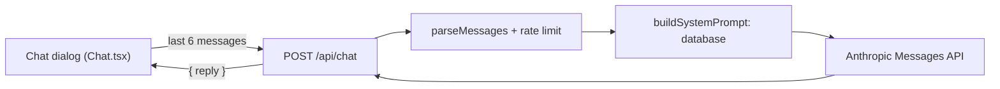

# Charter chatbot Agneta

A visitor can ask **Agneta**, a grumpy travel agent, about the charter destinations and how to book a charter trip. She answers from our own data only (a course task: the whole knowledge base is sent with every question instead of a retriever). Requirements: [`specs/TRIP-017-charter-chatbot/`](../../specs/TRIP-017-charter-chatbot/solution.md).

## On the page

The button "Fråga Agneta" (fixed at the bottom right) is on the start page and on every page under `/charter` (`app/charter/layout.tsx`), and nowhere else. It opens a `Dialog` (`wide`). The conversation is state in `Chat.tsx`, so it is kept when the dialog is closed and opened again, and gone after a reload. Each question sends the last 6 messages (never starting with an answer). A failed question is shown but not sent again. Answers and the text "Agneta tänker …" are in a `role="log"` region, so a screen reader announces them without moving focus.

## The route

`POST /api/chat` takes `{ messages }` and answers `{ reply }`.

| Status | When |
|---|---|
| 400 | `parseMessages` refuses the body: not 1 to 6 messages, a first message that is not a question, roles that do not alternate, a last message that is not a question, an empty text, a question over 500 or an answer over 4 000 characters. Nothing is sent to the API. |
| 429 | More than 10 questions in 5 minutes from one IP address (`CHAT_LIMIT`, counted in the database like the other [rate limits](rate-limits.md), not applied to a local run). `Retry-After` in seconds. |
| 502 | The API fails, takes over 50 seconds, refuses or answers with nothing. |

The chat shows the same in-character Swedish text for every failure and a "come back in N minutes" text for 429; never a status code, an API message or the key. The route logs only the class name of an error, never the error.

## The system prompt

`buildSystemPrompt()` in `lib/chat-prompt.ts` is read from the database at every request and has: the instructions and the voice, the booking text, and one `<destination id="…">` block per destination, sorted by id, with title, aliases, country, region, locality, category, access, airports, ways of getting there, tags, the airport and "round trip from" price the destination page shows (`tripTo`), the timetables between that airport and Arlanda or Köpenhamn (days, period, local departure and arrival time, airline and flight numbers, changes, price), and the three page texts. A destination with no flights has the page's notice instead. The text holds no date, time or photo credit, so it is the same on every call while the data is, which is what makes prompt caching work (about 40 000–50 000 tokens). The booking text must match [Boka en charterresa](../manual/boka-charter.md); change both together.

## The model call

`askAgneta()` in `lib/chat.ts` is the one place that reads `LLM_API_KEY`. It calls the official SDK with model `claude-sonnet-5-5`, `max_tokens` 600, the system prompt, a top-level `cache_control: { type: "ephemeral" }`, and writes the `usage` of every response to the log (`cache_read_input_tokens` above 0 on a second question within five minutes shows that the cache works). The key is only in Vercel (Production and Preview) and `.env.local`, never in the browser, a log or an error.

## Tests

All automatic tests run with `LLM_MOCK=1` (set by `scripts/test-server.mjs`): a fake client answers `Svar från Agneta på: <question>`, and fails on a question containing `FEL`; no request leaves the server and nothing costs the course's cap. The real model is tried by hand once on the preview and once live (see `specs/TRIP-017-charter-chatbot/verification.md`). Unit tests: `lib/chat-rules.test.ts`, `lib/chat-prompt.test.ts`, `lib/chat.test.ts`. Browser tests: `tests/TRIP-017-charter-chatbot.spec.ts`.

[System documentation](index.md)
