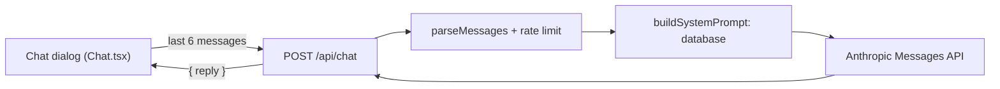
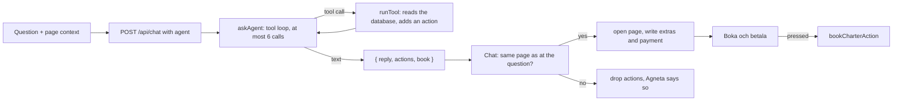

# Charter chatbot Agneta

A visitor can ask **Agneta**, a grumpy travel agent, about the charter destinations and how to book a charter trip. She answers from our own data only (a course task: the whole knowledge base is sent with every question instead of a retriever). Requirements: [`specs/TRIP-017-charter-chatbot/`](../../specs/TRIP-017-charter-chatbot/solution.md); her voice, answer format, panel, bubbles and saved conversation are [`specs/TRIP-032-karen-improvements/`](../../specs/TRIP-032-karen-improvements/solution.md), polished by [`specs/TRIP-033-agneta-polish/`](../../specs/TRIP-033-agneta-polish/solution.md): header, greeting, whole answers and the list format (the card was written when the character had another working name, hence the folder name). Her full name in the chat header is Agneta Spydenius. In the **agent mode** she can also steer the page and take the visitor to a booking: [`specs/TRIP-030-booking-agent/`](../../specs/TRIP-030-booking-agent/solution.md), described in [The agent mode](#the-agent-mode) below.

## On the page

The button "Fråga Agneta" (fixed at the bottom right, with her portrait) is on the start page, on every page under `/charter` (`app/charter/layout.tsx`) and on every page under `/flyg` (`app/flyg/layout.tsx`, TRIP-036) and on Min bokning (`app/min-bokning/layout.tsx`, TRIP-037), and nowhere else. `Chat.tsx` shows the chat in one of two ways with the same content (`ChatBody.tsx`): from the `lg` breakpoint a **panel** on the right (`section` named "Agneta", `fixed`, 26 to 36 rem wide (`clamp(26rem, 25vw, 36rem)`), not modal), below it a `Dialog` (`wide`). While the panel is open `Chat` sets `data-agneta-panel` on `<html>` and `globals.css` gives `body` the same margin on the right, so the page, header and footer are pushed together instead of covered.

- **Saved in the tab.** The conversation and whether the chat is open live in `sessionStorage` (`useSavedChat.ts`, read and checked by `parseSaved` in `lib/chat-saved.ts`; damaged or old data gives an empty chat). They follow the visitor between the start page, the charter pages and the flight pages and survive a reload, and are gone with the tab. Nothing is sent to the server. **Minimise** (and Escape) hides the chat and keeps the conversation. **Close** asks "Är du säker?" and then clears it, so the next opening is a new chat with a new connecting view and greeting; an answer to a question sent before is dropped (`chatEpoch` in `useSavedChat.ts`, so it cannot land in the new chat) and the waiting state is reset.
- **Connecting and greeting.** The first time the chat opens in a session (no entries yet) it shows "Kopplar in Agneta …" with a spinner (`role="status"`, still for `prefers-reduced-motion`) for 2 to 3 seconds, then adds the greeting `GREETING` ("Vad vill du?!", `lib/chat-rules.ts`) as the first entry. It is not an API call, and `lastMessages` drops it (a conversation must start with a question), so it is never sent.
- **Header.** Her portrait, "Agneta Spydenius", under it "Kundtjänstmedarbetare" and a green dot with the word "Live" (always shown; the dot is decorative), and the minimise and close buttons.
- **Bubbles.** The visitor's questions are on the right in the accent colour, her answers on the left in a darker bubble, each with a squared corner towards the sender. Answers are read by `parseAnswer` and `parseInline` in `lib/markdown.ts` and shown by `Answer.tsx`: paragraphs, lists with sub-lists, bold, and links only to `/charter/<id>`; anything else (other links, HTML) is plain text. A link that is not whole at the end of a text (`[Name](/charter/ab`) is removed, never shown as text.
- **Keyboard.** Opening by the button moves focus to the field; closing (after the question) or minimising returns it to the button; Escape minimises both the dialog and the panel; the panel has no focus trap.

Each question sends the last 6 messages (never starting with an answer). A failed question is shown but not sent again. Answers and the text "Agneta tänker …" are in a `role="log"` region, so a screen reader announces them without moving focus.

## The route

`POST /api/chat` takes `{ messages }` and answers `{ reply }`.

| Status | When |
|---|---|
| 400 | `parseMessages` refuses the body, or `agent` is present and `parseAgentContext` refuses it: not 1 to 6 messages, a first message that is not a question, roles that do not alternate, a last message that is not a question, an empty text, a question over 500 or an answer over 12 000 characters. Nothing is sent to the API. |
| 429 | More than 10 questions in 5 minutes from one IP address (`CHAT_LIMIT`, counted in the database like the other [rate limits](rate-limits.md), not applied to a local run). `Retry-After` in seconds. |
| 502 | The API fails, takes over 50 seconds, refuses or answers with nothing. |

The chat shows the same in-character Swedish text for every failure and a "come back in N minutes" text for 429; never a status code, an API message or the key. The route logs only the class name of an error and its HTTP status, never the error.

## The agent mode

A request for something done ("kan du boka åt mig?") makes Agneta end her answer with the line `[[HELP]]`. The route takes it out and answers `{ reply, help: true }`, and the chat shows the button **Hjälp mig** under the answer. Pressing it sets `agent` in the saved chat: the bar "Agneta hjälper dig" with **Sluta** shows, and every question now carries the page context. The mode is saved with the conversation and cleared with it.

- **Context.** Each question carries `{ url, extras, payment, valid }`: the path and query, the codes of the chosen extras, the payment method, and whether the traveller form passes `charterProblems`. Names, ages, contact details and the three questions never leave the browser, and nothing of the context is logged. On the server `readPage()` (`lib/agent-page.ts`) reads the address with the pages' own parsers and checks trips and dates against the database; what does not parse is "a page you do not know". The model is told this in a `<page>` block in the last user message, never in the system text, which stays the same so that it is cached.
- **Tools** (`lib/agent-tools.ts`): `show_destinations` (list with search and filters), `show_destination`, `find_trips` (the trips and prices the results page shows), `show_results`, `show_plan` (straight to the plan step with both trips), `list_aircraft`, `set_plan`, `list_addons`, `set_addons`, `show_travellers` (Resenärer, refused until both trips have aircraft and classes), `show_payment` (the payment page, refused until the traveller form is valid), `set_extras`, `set_payment` and `summarise` (with the total from the database). A tool only reads and adds an *action*; wrong arguments, an unknown destination or dates that cannot be booked give the model an error text and nothing happens. There is no tool that books.
- **Aircraft and classes** (TRIP-040, [`specs/TRIP-040-charter-agent-plan/`](../../specs/TRIP-040-charter-agent-plan/solution.md)). The steps are results, plan, Resenärer, payment. `list_aircraft` gives the aircraft that seat the party with room and price per person per class for each trip (`aircraftText()` in `lib/agent-plan.ts`: the departure's price × the aircraft's × the class's factor, no flight time, since charter ignores the time factor). `set_plan` sets one trip's aircraft and numbers per class and opens the plan step with them in the address; `checkPlan()` (also in `lib/agent-plan.ts`, written so that a flight agent can use it) refuses an aircraft that is too small, an unknown class, a class over its room or numbers that do not add up to the travellers, and says what, and the page checks the address again. `list_addons` and `set_addons` (counts per traveller, on both trips, where the add-on exists in the traveller's class; beer is left to the visitor because of the age rule) need aircraft and classes set for both trips. The tools work on the page the visitor is on (`state.url`), so several can be chained in one answer.
- **The class is fixed after the plan step** (TRIP-041-R4). `AGENT_RULES` and the page text for Resenärer say that the classes are decided in the plan step only and are shown, not changed, on Resenärer; she asks about add-ons only once the classes are set, and a visitor who wants another class on Resenärer is sent back with `set_plan` (an allowed address, `plan`), never told it is changed there. The add-ons she sets stay limited to the class each traveller has. The fake agent answers a question containing `ANNANKLASS` by listing the aircraft, setting the plan and saying so.
- **The loop** (`lib/agent.ts`): the model is called with the tools until it answers in text. After 6 tool calls the next request has `tool_choice: none` and must answer; after 35 s of a 55 s budget it is forced the same way, with what is left of the budget as the request's timeout and no retries. The `usage` of every request is logged.
- **Actions** (`lib/agent-rules.ts`): `goto` (only `/charter`, a destination, `resor`, `plan`, `boka`, `boka/betala`; `isAgentUrl`), `extras`, `payment` and `addons` (`{ legKeys, passengers }`: every traveller's class and add-ons per trip, checked in shape and size by `safeActions`). The chat checks them again (`safeActions`) and carries them out only if `readContext()` is the same as when the question was sent; otherwise it drops them and adds Agneta's line "Du hann ändra något medan jag höll på …". Extras and add-ons are written to the same `sessionStorage` form as the Resenärer page (add-ons with the trips' keys, so the page keeps them while the trips, aircraft and numbers are the same; a new plan in the same answer drops them), and the drinks package is removed when a traveller is under 18.
- **The payment step** (TRIP-038, [`specs/TRIP-038-agent-payment-step/`](../../specs/TRIP-038-agent-payment-step/solution.md)). The order in `AGENT_RULES` follows the booking's pages: on Resenärer she asks about add-ons and extras, never about payment (the visitor cannot see that choice there); when the form is valid she opens the payment page with `show_payment`, asks how to pay, sets it with `set_payment`, sums up, asks the visitor to check that it is right, and only then ends with `[[BOOK]]`.
- **The booking button.** The model ends the summary with `[[BOOK]]`. The server removes it and answers `book: true` only if the form is valid, a payment method is set and the page is the payment page (TRIP-038-R2; never Resenärer) with both trips found in the database and aircraft and classes set for both, and the answer did not move the page. **Boka och betala** calls `bookCharterAction()` (via `bookCharter()` in `app/charter/book.ts`, which Betala uses too) from the page's address and the saved form, with the same checks, total and rate limit; a failure shows the action's message under the button. Nothing else can book.
- **Voice.** An extra system block (`AGENT_RULES`) says she is Agneta in every answer in the mode, also when she asks, confirms, refuses or reports an error.

### Flights (TRIP-036)

Agneta also books ordinary flights, in the same mode, with the same loop, actions and button ([`specs/TRIP-036-flight-agent/`](../../specs/TRIP-036-flight-agent/solution.md)). The page's address tells which kind of booking the visitor is on (`isFlightUrl()` in `lib/agent-rules.ts`; `isAgentUrl` accepts `/flyg`, `/flyg/plan`, `/flyg/boka` and `/flyg/boka/betala`), and everything that differs follows from that.

- **Page.** `readPage()` gives the kind `flight` (`lib/agent-page.ts`): `readFlight()` in `lib/agent-flight.ts` reads the search with `parseSearch`, the departures that run on the dates with `findFlights()`, the departures in the address (`ut`, `hem`, a time each) and their plan with `parsePlan` and `checkChoice`, and the booking legs with `bookingLegs()`, so what she is told is what the page shows. A departure that does not run is "none yet".
- **Tools.** New: `find_airports`, `find_flights` (the departures and the "from" price per person the results page shows), `show_flights` (the results page; with `outbound_flight` and `return_flight`, departure times, only when both are given, as the results page shows a choice only with all legs in the address) and `show_flight_plan` (the shortcut straight to the plan step). The search is checked like the form checks it: airports that exist, dates that can be booked, a return on or after the outbound. `list_aircraft`, `set_plan`, `list_addons`, `set_addons`, `show_travellers`, `show_payment`, `set_payment` and `summarise` are the same tools as for charter and work on the page's booking (`Booking` in `lib/agent-tools.ts`, built by `charterBooking()` or `flightBooking()`). For flights `list_aircraft` gives each aircraft's flight time, arrival (`flightAircraftText()`: `aircraftOptions()` and `classOptions()` as the plan step), the price per person per class and the comparison with the cheapest and the fastest. `set_extras` is refused on flights.
- **Add-ons.** `set_addons` writes the add-ons for every traveller on each flight, where the add-on is sold in the traveller's class. Unlike charter it also sets beer (ages are unknown to the server): the answer tells her to warn that beer is for adults only, and the form removes it when an age under 18 is chosen (TRIP-029). Add-ons are written to the flight form (`gurrasflyg-bokning`) by `applyActions()` in `app/components/chatAgent.ts`, which picks the form from the page's address.
- **Voice and rules.** `AGENT_RULES` has a section "Ordinary flights": ask once for what is missing, find airports and flights with the tools, recommend an aircraft in a funny, negative way from the real prices and times, ask once "ser du någon addon du gillar?", never ask for ages or personal details. The plain chat's instructions end with `[[HELP]]` also for a request to find or book an ordinary flight.
- **The button.** `[[BOOK]]` is honoured on the flight payment page only (`/flyg/boka/betala`) with a valid form, a payment method and aircraft and classes set. **Boka och betala** calls `bookAction()` through `bookFlight()` (`app/flyg/boka/book.ts`, shared with Betala) from the page's address and the saved form. The form's total on the server is the seats and the add-ons she set; the visitor's own choices in the form and Dåliga nerver are not known to it.

### Min bokning (TRIP-037)

Agneta helps a visitor find a booking and choose what to cancel, with the same mode, loop and actions ([`specs/TRIP-037-cancel-agent/`](../../specs/TRIP-037-cancel-agent/solution.md)). The page is [My booking](my-booking.md); `isAgentUrl` accepts `/min-bokning`.

- **She never looks anything up.** The tools are `show_my_booking` (opens the page) and `tick_cancellation`; there is no tool that looks a booking up or cancels one, and none takes a number or a name. `MY_BOOKING_RULES` (`lib/agent.ts`) tells her that the visitor types the number and the last name in the page's fields, that she never asks for them, uses ones written in the chat or repeats them, and that a lost number cannot be found. The lookup stays `lookUpAction` with its limit and its same answer for a wrong number and a wrong name (TECH-026).
- **The extract.** When a booking is found the page registers an extract of it (`bookingExtract()` in `lib/cancel-extract.ts`, passed through `app/min-bokning/bookingBridge.ts`) and `readContext()` sends it as `booking` with each question; no booking, no field. The extract has, per flight or for the charter trip, route, date, departure and whether it is too late, and per part an id, "Resenär 1" with class, the amount and whether it is cancelled, plus the ids ticked now. It has no field for a name, contact detail, booking number, payment or address. The route checks its shape (`parseExtract`), accepts it only for `/min-bokning`, and does not log it.
- **Ticking.** `tick_cancellation` takes the ids to tick (replacing the boxes ticked now) among the extract's parts; a part that is already cancelled or on a flight that is too late is not ticked and the answer says why, and what a win would refund is in the answer. The result is a `tick` action; the chat carries it out only if the page is unchanged, and the page ticks only what `tickableIds()` allows, so a wrong id does nothing. The page announces "Agneta kryssade: …" in a `role="status"` and focus stays in the chat.
- **Cancelling is the page's.** Nothing she says or calls cancels: the visitor presses **Avboka** and answers **Ja, avboka**, which calls `cancelAction` as before. `[[BOOK]]` is never honoured there. She explains the rules in her voice from the page's own text (`LOTTERY_TEXT`, the 24 hours, no undo) and never promises a refund.

## The system prompt

`buildSystemPrompt()` in `lib/chat-prompt.ts` is read from the database at every request and has: the instructions (including the answer format: short, bold, the destination's page as a link `[Title](/charter/id)` with its name in full on every page, and for several destinations one bullet each with the name as a link and a short summary plus exactly one sub-bullet with the airport and the price "from" per person) and the voice (grumpy but not tiring, the tone from the very first answer, never starting by repeating the question, now and then one short random remark, at most one trait per answer), the booking text, and one `<destination id="…">` block per destination, sorted by id, with title, its page path (`Page: /charter/<id>`), aliases, country, region, locality, category, access, airports, ways of getting there, tags, the airport and "round trip from" price the destination page shows (`tripTo`), the timetables between that airport and Arlanda or Köpenhamn (days, period, local departure and arrival time, airline and flight numbers, changes, price), and the three page texts. A destination with no flights has the page's notice instead. The text holds no date, time or photo credit, so it is the same on every call while the data is, which is what makes prompt caching work (about 125 000 tokens, measured in the live log). The booking text must match [Boka en charterresa](../manual/boka-charter.md); change both together.

## The model call

`askAgneta()` in `lib/chat.ts` is the one place that reads `LLM_API_KEY`. It calls the official SDK with model `claude-sonnet-5-5`, `max_tokens` 3000 (the model thinks before it writes and the thinking counts against the limit: 902 of 1 000 tokens in one live log, which left about 60 words of answer), the system prompt, a top-level `cache_control: { type: "ephemeral" }`, and writes the `usage` of every response to the log. If the model stops at the limit (`stop_reason: "max_tokens"`) the event is logged too and the answer is cut by `cutToWhole` at the last whole bullet (with its sub-bullet), paragraph or word, so it never ends in a name or a link. The usage log shows that the cache works when `cache_read_input_tokens` is above 0 on a second question within five minutes. The key is only in Vercel (Production and Preview) and `.env.local`, never in the browser, a log or an error.

## Tests

All automatic tests run with `LLM_MOCK=1` (set by `scripts/test-server.mjs`): a fake client (`lib/chat-mock.ts`) answers `Svar från Agneta på: <question>`, fails on a question containing `FEL`, answers a list cut in a link on `KAPAD`, offers the Hjälp mig button for "hjälp mig" and "boka åt mig", and in the agent mode runs a script chosen by a word in the question (`LISTA`, `GENVAG`, `RESULTAT`, `FLYGPLATS`, `FLYGSOK`, `FLYGUTVAL`, `FLYGVAG` (the flight versions of the tools and of `GENVAG`), `PLAN`, `OGILTIGT`, `FORSTORA`, `TILLAGGSLISTA`, `KLASSTILLAGG`, `TILLAGG` (extras only), `BETALSIDAN`, `BETALSATT`, `BOKA`, `SLINGA`, `OTILLATEN`) through the real tools and loop; no request leaves the server and nothing costs the course's cap. The real model is tried by hand once on the preview and once live (see `specs/TRIP-017-charter-chatbot/verification.md`). Unit tests: `lib/chat-rules.test.ts`, `lib/chat-prompt.test.ts`, `lib/chat.test.ts`, `lib/agent-rules.test.ts`, `lib/agent.test.ts`. Browser tests: `tests/TRIP-037-cancel-agent.spec.ts` (`MINBOKNING`, `KRYSSA del=…`, `UPPGIFTER` in the fake agent; the bookings are written into the test database) and `tests/TRIP-030-booking-agent.spec.ts` and `tests/TRIP-040-charter-agent-plan.spec.ts` and `tests/TRIP-038-agent-payment-step.spec.ts` and `tests/TRIP-036-flight-agent.spec.ts` (each test has its own `x-forwarded-for` address, since the limit is 10 questions in 5 minutes) and `tests/TRIP-017-charter-chatbot.spec.ts` and `tests/TRIP-032-karen-improvements.spec.ts` and `tests/TRIP-033-agneta-polish.spec.ts` (`agnetaGreeted` in `tests/helpers.ts` starts a test with the greeting already made; the connecting view is tested with Playwright's fake clock).

[System documentation](index.md)
