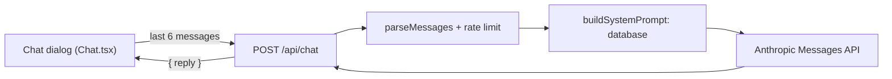

# Charter chatbot Agneta

A visitor can ask **Agneta**, a grumpy travel agent, about the charter destinations and how to book a charter trip. She answers from our own data only (a course task: the whole knowledge base is sent with every question instead of a retriever). Requirements: [`specs/TRIP-017-charter-chatbot/`](../../specs/TRIP-017-charter-chatbot/solution.md); her voice, answer format, panel, bubbles and saved conversation are [`specs/TRIP-032-karen-improvements/`](../../specs/TRIP-032-karen-improvements/solution.md), polished by [`specs/TRIP-033-agneta-polish/`](../../specs/TRIP-033-agneta-polish/solution.md): header, greeting, whole answers and the list format (the card was written when the character had another working name, hence the folder name). Her full name in the chat header is Agneta Spydenius.

## On the page

The button "Fråga Agneta" (fixed at the bottom right, with her portrait) is on the start page and on every page under `/charter` (`app/charter/layout.tsx`), and nowhere else. `Chat.tsx` shows the chat in one of two ways with the same content (`ChatBody.tsx`): from the `lg` breakpoint a **panel** on the right (`section` named "Agneta", `fixed`, 26 to 36 rem wide (`clamp(26rem, 25vw, 36rem)`), not modal), below it a `Dialog` (`wide`). While the panel is open `Chat` sets `data-agneta-panel` on `<html>` and `globals.css` gives `body` the same margin on the right, so the page, header and footer are pushed together instead of covered.

- **Saved in the tab.** The conversation and whether the chat is open live in `sessionStorage` (`useSavedChat.ts`, read and checked by `parseSaved` in `lib/chat-saved.ts`; damaged or old data gives an empty chat). They follow the visitor between the start page and the charter pages and survive a reload, and are gone with the tab. Nothing is sent to the server. **Minimise** (and Escape) hides the chat and keeps the conversation. **Close** asks "Är du säker?" and then clears it, so the next opening is a new chat with a new connecting view and greeting; an answer to a question sent before is dropped (`chatEpoch` in `useSavedChat.ts`, so it cannot land in the new chat) and the waiting state is reset.
- **Connecting and greeting.** The first time the chat opens in a session (no entries yet) it shows "Kopplar in Agneta …" with a spinner (`role="status"`, still for `prefers-reduced-motion`) for 2 to 3 seconds, then adds the greeting `GREETING` ("Vad vill du?!", `lib/chat-rules.ts`) as the first entry. It is not an API call, and `lastMessages` drops it (a conversation must start with a question), so it is never sent.
- **Header.** Her portrait, "Agneta Spydenius", under it "Kundtjänstmedarbetare" and a green dot with the word "Live" (always shown; the dot is decorative), and the minimise and close buttons.
- **Bubbles.** The visitor's questions are on the right in the accent colour, her answers on the left in a darker bubble, each with a squared corner towards the sender. Answers are read by `parseAnswer` and `parseInline` in `lib/markdown.ts` and shown by `Answer.tsx`: paragraphs, lists with sub-lists, bold, and links only to `/charter/<id>`; anything else (other links, HTML) is plain text. A link that is not whole at the end of a text (`[Name](/charter/ab`) is removed, never shown as text.
- **Keyboard.** Opening by the button moves focus to the field; closing (after the question) or minimising returns it to the button; Escape minimises both the dialog and the panel; the panel has no focus trap.

Each question sends the last 6 messages (never starting with an answer). A failed question is shown but not sent again. Answers and the text "Agneta tänker …" are in a `role="log"` region, so a screen reader announces them without moving focus.

## The route

`POST /api/chat` takes `{ messages }` and answers `{ reply }`.

| Status | When |
|---|---|
| 400 | `parseMessages` refuses the body: not 1 to 6 messages, a first message that is not a question, roles that do not alternate, a last message that is not a question, an empty text, a question over 500 or an answer over 6 000 characters. Nothing is sent to the API. |
| 429 | More than 10 questions in 5 minutes from one IP address (`CHAT_LIMIT`, counted in the database like the other [rate limits](rate-limits.md), not applied to a local run). `Retry-After` in seconds. |
| 502 | The API fails, takes over 50 seconds, refuses or answers with nothing. |

The chat shows the same in-character Swedish text for every failure and a "come back in N minutes" text for 429; never a status code, an API message or the key. The route logs only the class name of an error, never the error.

## The system prompt

`buildSystemPrompt()` in `lib/chat-prompt.ts` is read from the database at every request and has: the instructions (including the answer format: short, bold, the destination's page as a link `[Title](/charter/id)` with its name in full on every page, and for several destinations one bullet each with the name as a link and a short summary plus exactly one sub-bullet with the airport and the price "from" per person) and the voice (grumpy but not tiring, the tone from the very first answer, never starting by repeating the question, now and then one short random remark, at most one trait per answer), the booking text, and one `<destination id="…">` block per destination, sorted by id, with title, its page path (`Page: /charter/<id>`), aliases, country, region, locality, category, access, airports, ways of getting there, tags, the airport and "round trip from" price the destination page shows (`tripTo`), the timetables between that airport and Arlanda or Köpenhamn (days, period, local departure and arrival time, airline and flight numbers, changes, price), and the three page texts. A destination with no flights has the page's notice instead. The text holds no date, time or photo credit, so it is the same on every call while the data is, which is what makes prompt caching work (about 40 000–50 000 tokens). The booking text must match [Boka en charterresa](../manual/boka-charter.md); change both together.

## The model call

`askAgneta()` in `lib/chat.ts` is the one place that reads `LLM_API_KEY`. It calls the official SDK with model `claude-sonnet-5-5`, `max_tokens` 1000, the system prompt, a top-level `cache_control: { type: "ephemeral" }`, and writes the `usage` of every response to the log. If the model stops at the limit (`stop_reason: "max_tokens"`) the event is logged too and the answer is cut by `cutToWhole` at the last whole bullet (with its sub-bullet), paragraph or word, so it never ends in a name or a link. The usage log shows that the cache works when `cache_read_input_tokens` is above 0 on a second question within five minutes. The key is only in Vercel (Production and Preview) and `.env.local`, never in the browser, a log or an error.

## Tests

All automatic tests run with `LLM_MOCK=1` (set by `scripts/test-server.mjs`): a fake client answers `Svar från Agneta på: <question>`, fails on a question containing `FEL`, and answers a list cut in a link on `KAPAD`; no request leaves the server and nothing costs the course's cap. The real model is tried by hand once on the preview and once live (see `specs/TRIP-017-charter-chatbot/verification.md`). Unit tests: `lib/chat-rules.test.ts`, `lib/chat-prompt.test.ts`, `lib/chat.test.ts`. Browser tests: `tests/TRIP-017-charter-chatbot.spec.ts` and `tests/TRIP-032-karen-improvements.spec.ts` and `tests/TRIP-033-agneta-polish.spec.ts` (`agnetaGreeted` in `tests/helpers.ts` starts a test with the greeting already made; the connecting view is tested with Playwright's fake clock).

[System documentation](index.md)
