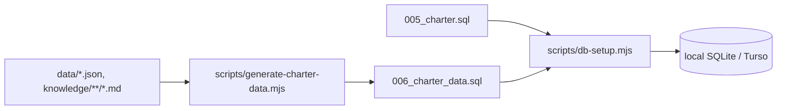

# Charter data in the database

The course's sample data for charter (`data/` and `knowledge/`) is imported into tables of its own, so the charter features can use ordinary queries. The course files themselves are read-only; the database holds a copy.

## How it gets there



- `db/migrations/005_charter.sql` creates the tables and their rules.
- `db/migrations/006_charter_data.sql` fills them. It is **generated**, never edited by hand: `node scripts/generate-charter-data.mjs > db/migrations/006_charter_data.sql`. The rows are sorted by ID, so the same course files always give the same file (a test checks this).
- Both run once per database with the other migrations (`scripts/db-setup.mjs`), locally, in CI's test database and on Turso. They only add tables and rows; existing data is kept.
- If the course data ever broke a rule, the migration would fail and nothing would be stored.

## Tables

| Table | One row per | Notes |
|---|---|---|
| `charter_airports` | airport in `data/airports.json` (136) | Key `iata`. Separate from the airline's `airports`, even where the code is the same. |
| `destinations` | destination (96) | Key `id`, for example `teufelsberg`. `nearest_airport` and `gateway_airport` refer to `charter_airports`. `nearest_distance_km` is `NULL` when the only way there is a long sea voyage (Grytviken, Whalers Bay); `gateway_airport` is `NULL` when the nearest airport is the main one. `status_source` comes from the page's frontmatter. |
| `destination_aliases`, `destination_tags`, `destination_transport` | alias, tag or way of getting there | `position` keeps the order of the course data. |
| `destination_pages` | destination | `overview`, `getting_there`, `visiting`: the three sections of the page as Markdown, without headings. |
| `destination_photos` | destination with a photo (95) | `src` (under `/images/`; the file stays in `public/images/`), `author`, `license`, `license_url` (`NULL` for public domain), `source`. Project Riese – Osówka has no credit in the course data, so it has no photo. |
| `charter_timetables` | timetable in `data/flights.json` (500) | Key `id`, for example `ARN-BER-EW488`. Local times `departs` and `arrives`, `arrival_day`, `duration_minutes`, `price` in whole kronor. |
| `charter_timetable_days` | weekday a timetable runs | `Mon` … `Sun`. |
| `charter_timetable_flights` | leg | Flight numbers in order (`position`). |
| `charter_timetable_stops` | change airport | In order (`position`); none for a direct flight. |

Dates are `YYYY-MM-DD` and times `HH:MM`, as in the course data.

### Rules

The tables reject data that doesn't hold together: unknown airports, missing required fields, a period that ends before it starts, an unknown or repeated weekday, a negative price, or a timetable from and to the same airport. Foreign keys are checked on local databases (the site and `db-setup.mjs` turn them on); the CI test database is built the same way, so a broken import is caught there before it reaches Turso.

### Prices

The course prices are in euros. They are stored as whole kronor, 1 EUR = 10 kr, like every price on the site: `ARN-BER-EW488` (129 €) costs 1 290 kr. The euro price is not stored.

### Arrival times and summer time

`arrives` is stored as it is in the course data, but it doesn't follow the change to summer time in March 2027: for 64–132 timetables `departs`, `arrives` and `duration_minutes` no longer add up then. The charter search will therefore work out the arrival from `departs` and `duration_minutes`, in each airport's time zone on the date.

## Examples

Timetables from ARN to BER on Monday 2027-01-11, by departure time:

```sql
SELECT t.id, t.departs, t.price
FROM charter_timetables t
JOIN charter_timetable_days d ON d.timetable_id = t.id
WHERE t.from_airport = 'ARN' AND t.to_airport = 'BER' AND d.weekday = 'Mon'
  AND '2027-01-11' BETWEEN t.valid_from AND t.valid_to
ORDER BY t.departs;
```

## Related

- Source files: [Flight timetables](data-flights.md), `data/airports.json`, `data/destinations.json`, the [destination pages](../../knowledge/index.md)
- Read by: [GET /api/destinations](api-destinations.md) (`lib/travel.ts`), and the charter search and booking (`lib/charter.ts`, [Charter booking](charter-booking.md)), which work out the arrival from `departs` and `duration_minutes`
- Tests: `tests/TRIP-007-import-course-data.spec.ts`
- Feature: card TRIP-007 (#11), `specs/TRIP-007-import-course-data/`
