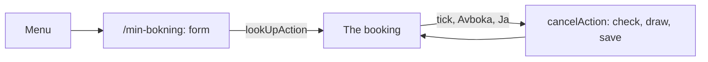

# My booking

A traveller opens **Min bokning** from the menu in the header, types the booking number and the contact's last name, sees the whole booking and ticks what to cancel. Cancelling is a lottery: the server draws once, and a win refunds the price of everything cancelled, a loss refunds nothing. The page says so before the button is pressed. Nothing real happens: the "refund" only lowers what is left to pay.

## The menu

`app/components/Menu.tsx` is the ring button "Meny" in the header of every page (next to the wordmark and, in a flow, Avbryt). It opens a list with Start, Min bokning and Admin; the footer has no links. `aria-expanded` says if it is open. Escape and a click outside close it and give the button its focus back. The list is open only on the page where it was opened, so it closes when the page changes. The items are `FlowLink` (`app/components/AbortFlow.tsx`): outside the flight and charter flows plain links; inside them buttons that ask "Är du säker?" first, as the wordmark does, and drop the booking only on "Ja, avbryt" ([Flows](flows.md)).

## Finding a booking

`/min-bokning` shows two fields, **Bokningsnummer** and **Efternamn**. `lookUpAction` (`app/min-bokning/actions.ts`) checks the types and lengths, then `lookUpBooking` in `lib/my-booking.ts`:

1. Counts the attempt for the address (see below).
2. Finds the booking by its number: six characters for a flight booking (`K7M2QX`), `CH-` and six for a charter booking (`bookingKind()` in `lib/cancel-rules.ts`). The number may be typed in any case with spaces around it.
3. Compares the last name with the contact's, in any case (`sameLastName`, Swedish letters included).
4. A wrong number, a wrong last name and a number of the wrong shape give the same answer, "Vi hittar ingen bokning med de uppgifterna.", so nobody can learn which numbers exist. An empty field is named ("Skriv bokningsnumret." / "Skriv efternamnet."). The fields keep what was typed.

The number and the last name are sent in the server action's request, never in the address, and the booking lives only in the page's state: a reload shows the empty form again.

**The limit.** After 5 wrong attempts from one address within 15 minutes the next ones are refused for 15 minutes, even with the right number and last name ("För många försök. Försök igen om N minuter."). It is the same mechanism as the admin sign-in ([Architecture](architecture.md), TECH-017): `registerLoginAttempt` counts before the check, in `login_attempts`, but with the key `uppslag:<ip>` so the two are counted apart. A right lookup clears the count. The address is the first entry of `x-forwarded-for`.

## The booking

`readFlightBooking` and `readCharterBooking` read everything from the database and build the view the page draws (types in `lib/cancel-rules.ts`):

- **Flight booking:** a card per flight (Utresa, Hemresa) with route, date, departure, aircraft and flight time, and for each passenger the name, age, class, add-ons and the price of the seat with its add-ons. Contact, payment method, total.
- **Charter booking:** the destination, the two trips (the timetable's data with the price that was booked), the passengers with their share (both trips and the extras, per person), the extras, contact, payment method and total.
- **Cancelled parts** are struck through with "Avbokad". With any cancellation the totals show **Totalt**, **Återbetalat** and **Kvar att betala** (`leftToPay`), and a card **Avbokningar** lists each cancellation with its time and outcome. A fully cancelled booking is shown as "Avbokad" and nothing can be ticked.

## Choosing what to cancel

- **Flight booking:** a box per flight ("Avboka utresan") that ticks all its passengers, and a box per passenger's seat. The outbound can be cancelled and the return kept, and the other way round. A flight with no active seat is cancelled; with every flight cancelled the booking is.
- **Charter booking:** "Avboka hela resan" and a box per traveller. The outbound or the return alone can't be chosen: a traveller is cancelled on both.
- **Too late.** A flight that departs in 24 hours or less, or has left, can't be ticked (`canCancel`): its boxes are `aria-disabled` and grey and described by "Det är för sent att avboka". The departure is judged in the departure airport's time zone, summer time included (`instant()` in `lib/fare-rules.ts`). A charter booking is judged by its outbound trip. The server checks the rule again.

Under the cards, **Avboka** (`CancelPanel`) tells the rules before any click: the booking is a lottery, 50/50, and on a loss the full price is paid anyway. With something ticked it lists what and shows what a win refunds. The button is disabled with nothing ticked. It opens the dialog "Är du säker?", which repeats what is cancelled, the amount, the lottery and that it can't be undone; only "Ja, avboka" cancels, Escape and "Nej" change nothing.

## The cancellation

`cancelAction` calls `cancelParts` with the booking number, the last name, a request id and the ids of the ticked seats or travellers. It sends **no amount and no outcome**. In one write transaction the server:

1. Counts the attempt and checks the number and last name again. A mismatch is refused and counts as a wrong attempt.
2. Reads the whole booking again and refuses (message "Det du valde går inte att avboka. Ladda om sidan och försök igen.", nothing changed) an empty selection, an id that is not in the booking, one already cancelled, one on a flight that is too late, or duplicates.
3. Sums the amount: seats with their add-ons, or travellers with both trips and the extras (`seatAmount`, `travellerAmount`).
4. Draws: `winsLottery(random)` with a random number from `crypto.randomInt`: below one half wins. A win refunds the amount.
5. Inserts the cancellation (time, outcome, amount, refunded) and marks the parts.

The page then shows "Grattis! Vi får se om du får några pengar tillbaka – du får det!" or "Du måste betala fullt pris ändå, ledsen för det. Hör av dig till våra advokater om du är missnöjd." The same confirmation sent twice (a double click) has the same request id and gives the cancellation that exists, with no second draw.

## Tables

Migration `012_cancellations.sql` adds `booking_cancellations` and `charter_booking_cancellations`, and a nullable `cancellation_id` on `booking_seats` and `charter_booking_passengers`. Nothing existing is changed; `bookings.total` stays what was booked.

## Tests

The rules are unit tests: `lib/cancel-rules.test.ts` (numbers, the 24 hours across time zones and summer time, the lottery, amounts, ticking) and `lib/my-booking.test.ts` (lookup, the limit, cancelling, double confirmation, refusals, charter). The pages are in `tests/TRIP-023-my-booking.spec.ts`, which writes its bookings straight into the test database (`tests/my-booking-data.ts`) and removes them. The browser tests accept either outcome of the lottery and check that the amounts follow the one shown.
