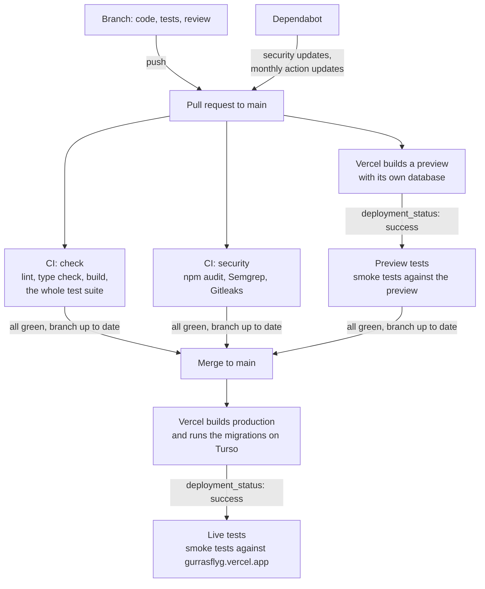

# Pipeline

Every change reaches the live site through a pull request to `main`. The whole test suite runs once, in CI, before the merge; after each deploy, a few read-only smoke tests check that the deployed site works. GitHub refuses a merge until the required checks are green. Which kind of test checks what is in [Testing](testing.md).

The diagram can be exported as a picture, for example with the Mermaid Live Editor (<https://mermaid.live>), for a presentation.

## The workflows

| Workflow | When | Against | What |
|---|---|---|---|
| **CI** (`ci.yml`), job `check` | Every pull request to `main`; by hand | A local production build with its own fresh test database, in Playwright's image | `npm run lint`, `npm run typecheck`, `npm run build`, `npm run test:local` (every browser test, also those that read the database) |
| **CI**, job `security` | Every pull request to `main`; by hand | The code and its whole Git history | `npm audit`, Semgrep, Gitleaks ([Testing](testing.md#security)) |
| **Preview tests** (`preview-tests.yml`) | When Vercel reports a preview as ready (`deployment_status`) | The pull request's preview on Vercel | `npm run test:smoke` |
| **Live tests** (`live-tests.yml`) | When Vercel reports a production deploy as ready (`deployment_status`); by hand | <https://gurrasflyg.vercel.app> | `npm run test:smoke` |

- **The whole suite runs once.** It runs in CI, where it also covers the tests that read the database (`runsLocally`). The preview and production get the smoke tests only: they show that the deploy works, and since they only read, production never gets test data and no production secret is used by a test.
- **CI doesn't run again on `main`.** Branch protection requires the branch to be up to date with `main`, so what CI tested is exactly what is merged.
- **`deployment_status`** is the event Vercel sends to GitHub when a deployment changes state, with the deployment's environment (Preview or Production), commit and address. It is turned on in Vercel under the project's Settings → Git. The run belongs to the deployed commit, so Preview tests shows on the pull request. Vercel also offers `repository_dispatch` events with more data, but those start from `main` and don't show on the pull request.
- **Secrets:** Preview tests uses the repository secret `VERCEL_AUTOMATION_BYPASS_SECRET` (created in Vercel under Settings → Deployment Protection → Protection Bypass for Automation) to get past the sign-in Vercel puts on previews; nothing else in the pipeline uses a real secret. CI makes up a throw-away admin password for its test server. Secrets are given only to the step that runs the tests, and every workflow's `GITHUB_TOKEN` can only read.
- **Playwright's image:** the test jobs run in `mcr.microsoft.com/playwright:v<version>-noble`, which already has Node, Chromium and its system libraries. Their shared setup (`.github/actions/setup-tests/`) runs `npm ci` and stops the job if the image's Playwright version differs from `@playwright/test`. When `@playwright/test` is updated, change the image's version in the three workflows to match.
- **Actions** are pinned to commits, and Dependabot proposes new versions once a month (TECH-012).
- **When tests fail,** the run saves Playwright's report with screenshots as an artifact. Traces are saved only for local runs, since a trace holds typed values and headers.
- **A newer push** to the same branch cancels the older CI run, and a newer preview cancels the older Preview tests run.
- **A skipped `live` check on pull requests** is expected: Vercel sends `deployment_status` for previews too, and Live tests skips everything that isn't production.

## Branch protection

`main` is protected (TECH-014-R6), which GitHub offers for free on a public repository:

- A change reaches `main` only through a pull request; direct pushes and force pushes are refused, and `main` can't be deleted.
- The checks `check` and `security` (CI), `preview` (Preview tests) and `Vercel` (Vercel's own status, which fails when the preview can't be built) must pass. Preview tests also fails when Vercel reports a failed deploy, since GitHub counts a skipped job as passed.
- The branch must be up to date with `main`. If it isn't, use "Update branch" on the pull request (or merge `main` into the branch) and wait for the checks again.
- No approving review is required, since the project has one developer who merges their own pull requests; the code review is done by the reviewer agent and posted on the pull request.

The time budgets for the jobs and the tests are in [Testing](testing.md#time-budgets).

[System documentation](index.md)
