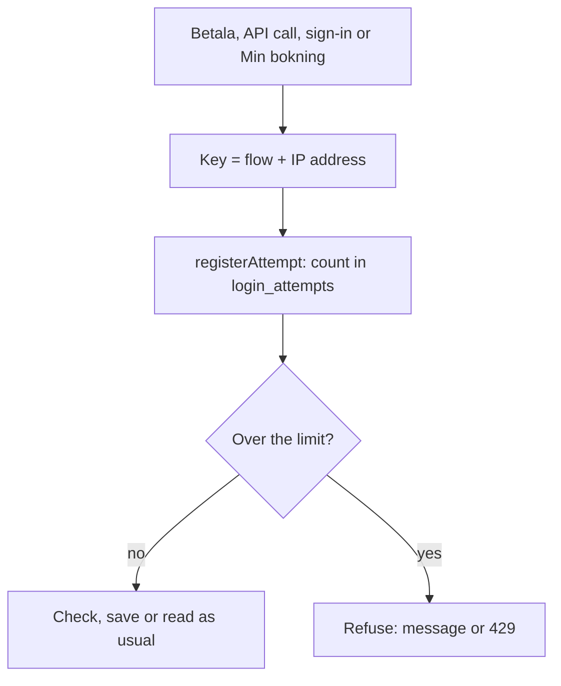

# Rate limits

Everything that anyone can call has a limit per IP address, so a script can't guess a password, fill the database with bookings or run up database reads. There are no accounts and no sensitive data, so the aim is to keep the site usable and cheap, not to stop a determined attacker. Requirements: [`specs/TECH-025-rate-limit/`](../../specs/TECH-025-rate-limit/solution.md).

## The limits

| Flow | Limit | Key in `login_attempts` | Answer when locked |
|---|---|---|---|
| Admin sign-in | 5 attempts in 15 minutes | `<ip>` | "För många försök. Försök igen om N minuter." |
| Min bokning (lookup and cancel) | 5 attempts in 15 minutes | `uppslag:<ip>` | the same message |
| Betala, flight and charter together | 10 presses in 15 minutes | `bokning:<ip>` | the same message, nothing is saved |
| `/api/airports`, `/api/destination-search`, `/api/destinations` | 60 calls in a minute, per route | `api:<route>:<ip>` | status 429, header `Retry-After` (seconds), `{ "error": "För många anrop. Försök igen om N sekunder." }` |

The sign-in and Min bokning count the window from the latest attempt, so a lock lasts 15 minutes after the last guess. Betala and the API routes count a fixed window from the first attempt (`fixedWindow`), so "10 in 15 minutes" and "60 in a minute" mean exactly that, and steady use spread over a longer time is never refused. Further attempts while locked don't extend the lock. A right password or a right lookup clears the sign-in's and Min bokning's count; Betala and the API routes never clear theirs.

## How it is built

- **`lib/rate-limit.ts`** holds the generic part. `registerAttempt(key, { max, windowMs, fixedWindow? })` runs one `INSERT … ON CONFLICT … RETURNING` that counts the attempt and reads the count in the same statement, so many requests at once can't slip past the limit. It returns `{ msLeft }` when the key is locked, otherwise `null`. The counters are in the database because on Vercel each request may run in a new function.
- **Cleanup.** The windows differ (15 minutes and 1 minute) but share one table, and a count only starts over when its old row is deleted (the column `last_failed_at` holds the time of the latest attempt, or with `fixedWindow` of the first). Each call therefore deletes the key's own row once it is older than the call's window, and every row older than `LONGEST_WINDOW_MS` (15 minutes), which is expired for all flows. A window longer than that is refused with an error.
- **`lib/login-limit.ts`** is the sign-in's limit on top of it; its exports are unchanged.
- **`lib/flow-limits.ts`** has the limits of Betala (`BOOKING_LIMIT`) and the API routes (`API_LIMIT`), and the two functions the code calls: `bookingLimitError()` in `bookAction` and `bookCharterAction`, `apiLimitResponse(route)` first in each route.
- **`lib/client-ip.ts`**: `clientIp()` is the first entry of `x-forwarded-for`, which Vercel sets itself, at most 45 characters.

## What is not limited

- A request without `x-forwarded-for` (`local`) is not limited by Betala and the API routes. Vercel always sets the header, so the live site is covered; a local run and the test suite, which books many times from one address, are not. The sign-in and Min bokning do count `local`.
- Every press of Betala counts, also one that fails the checks. A refused address can still open pages and use the rest of the site.
- The exemption of `local` is safe on Vercel, which overwrites `x-forwarded-for`. Behind another proxy it and `clientIp()` would need a second look.
- Anyone behind a shared address (an office, a school) shares one count.

## Also in this change

`bookAction` and `bookCharterAction` refuse an address (`query`) longer than `MAX_QUERY_LENGTH` (1 000 characters, `lib/booking-rules.ts`) as "ändrats", before anything is counted or read.

## Tests

Unit tests: `lib/rate-limit.test.ts` (the numbers, the windows, the cleanup per flow, a window that is too long), `lib/login-limit.test.ts` (unchanged) and `app/flyg/boka/actions.test.ts` (the length of the address). Browser tests: `tests/TECH-025-rate-limit.spec.ts` uses an address of its own with the counter already filled in the test database and checks the message on Betala and the 429 from the routes.

[System documentation](index.md)
